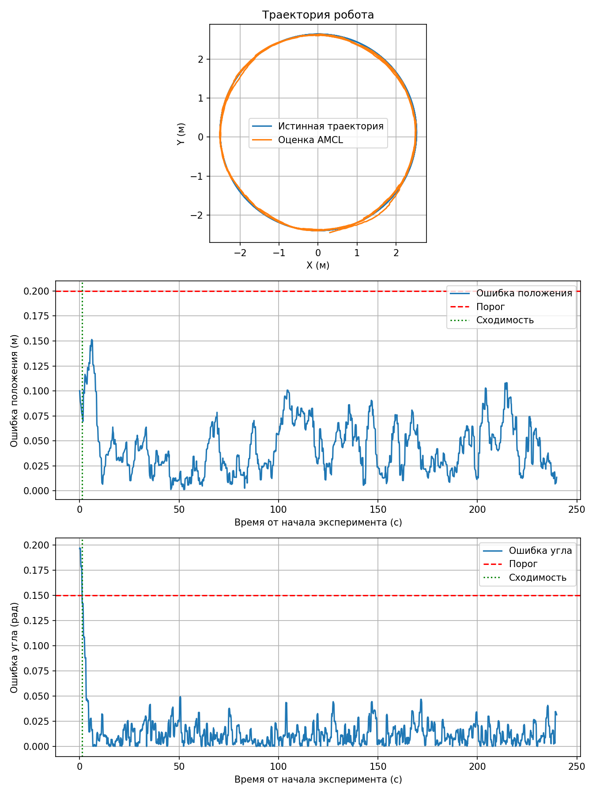
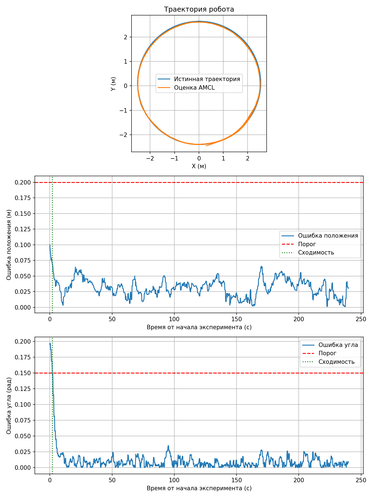
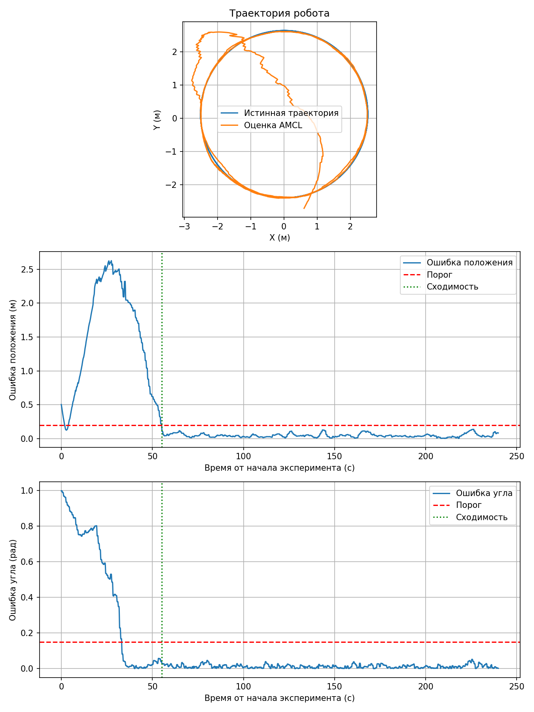
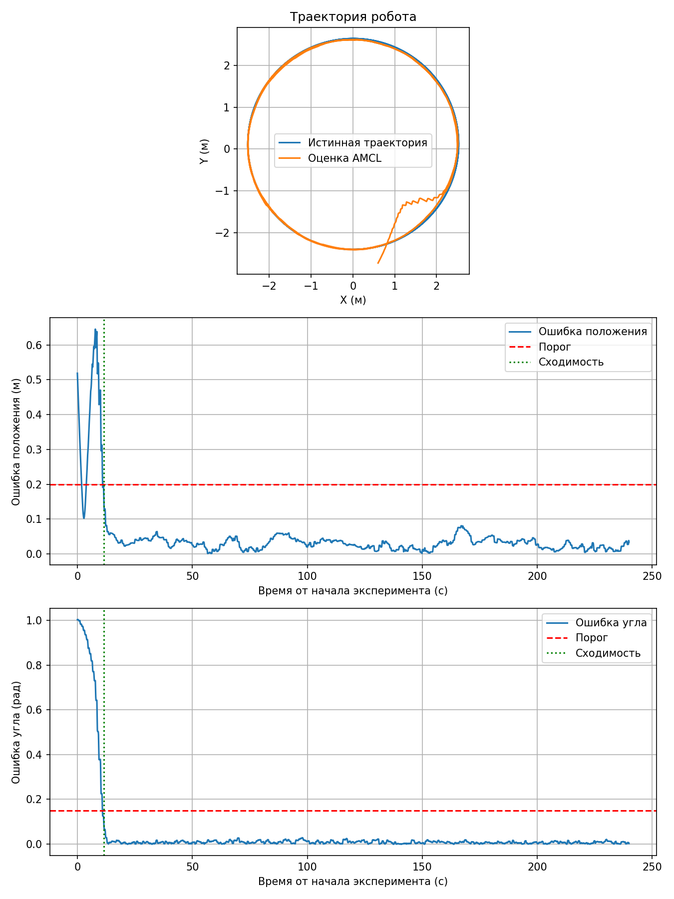
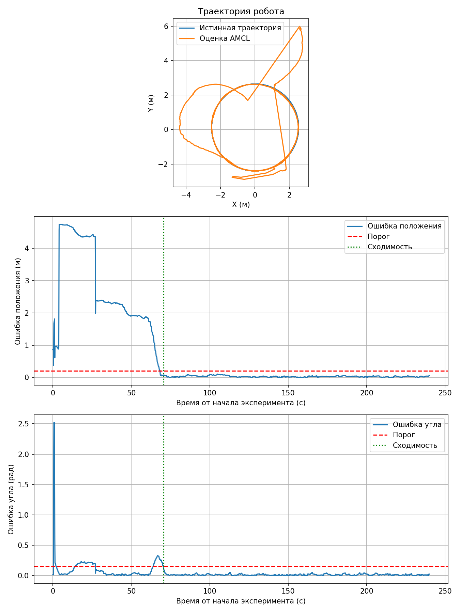
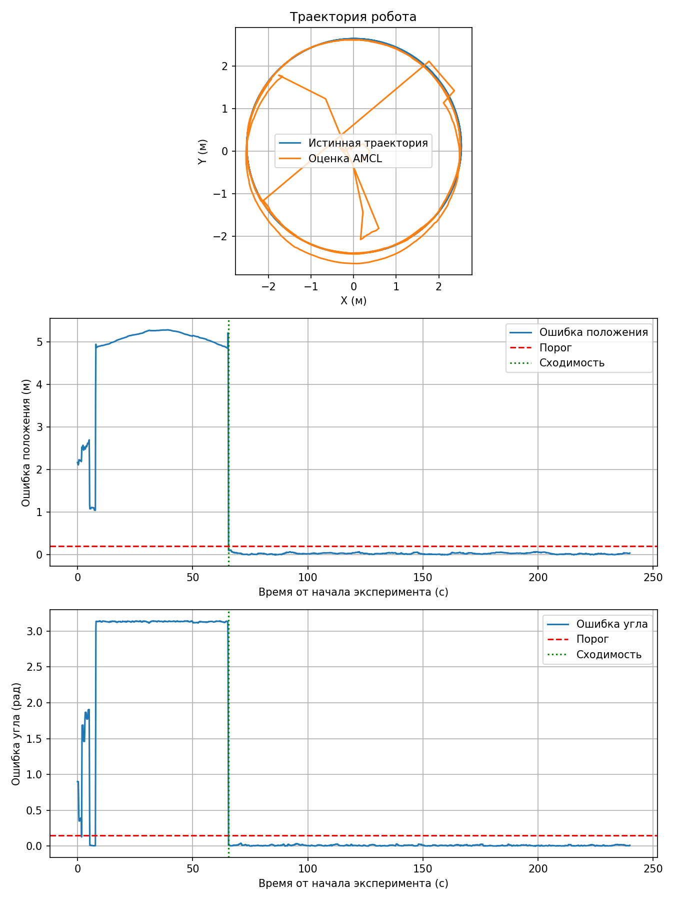

# Практическая работа 3. Одометрия и системы координат
## Примечание
**Практическая работа выполнена на macOS**
## Иструкция
**1. Запуск скрипта-сервера Webots в терминале на macOS**

``` bash 
export WEBOTS_HOME=/Applications/Webots.app
python3 local_simulation_server.py
```

**2. Перейти в репозиторий в Ubuntu**

``` bash 
cd 2026-Project-Seminar-Mobile-Wheeled-Robots
```

**3. Сделать сборку среды**

``` bash
HOST_XAUTHORITY="$XAUTHORITY" docker compose --env-file .env --env-file .env.local -f docker-compose.yaml -f docker-compose.gpu.yaml -f docker-compose.webots-mac.yaml build
```
**4. Запустить среду разработки** 

``` bash 
HOST_XAUTHORITY="$XAUTHORITY" docker compose --env-file .env --env-file .env.local -f docker-compose.yaml -f docker-compose.gpu.yaml -f docker-compose.webots-mac.yaml up -d
```

``` bash
HOST_XAUTHORITY="$XAUTHORITY" docker compose --env-file .env --env-file .env.local -f docker-compose.yaml -f docker-compose.gpu.yaml -f docker-compose.webots-mac.yaml exec -it ros2-base zsh
```

**5. Собрать рабочее пространство**
``` bash
colcon build
```

**6. Активировать окружение**

```bash
source install/setup.zsh
```
**7. Запуск экспериментов**

Для определения положения робота используется AMCL. Истинное положение берётся из Webots с помощью Ground Truth. Программа `test.py` получает данные через TF2, считает ошибки положения и угла и определяет время сходимости.
Время каждого эксперимента составляет 240 секунд симуляции.

**Параметры сходимости**

| Параметр | Значение |
|---|---|
| Порог ошибки положения | 0.2 м |
| Порог ошибки угла | 0.15 рад |
| Время подтверждения сходимости | 10 с |
| Длительность эксперимента | 240 с |

Сходимость считается подтверждённой, если обе ошибки не превышают пороги в течение 10 секунд. Время сходимости считается от начала этого интервала.

**Количество частиц AMCL**

| Режим | min_particles | max_particles |
|---|---|---|
| Малое количество | 100 | 500 |
| Большое количество | 500 | 12000 |

**Ошибки начальной догадки**

| Ошибка | X (м) | Y (м) | Yaw (рад) |
|---|---|---|---|
| Малая | 0.1 | -0.1 | 0.2 |
| Большая | 0.5 | -0.5 | 1.0 |

Для сохранения результатов задаётся папка `results`.

**Эксперимент 1. Малая ошибка, 500 частиц**

```bash
ros2 launch practice_04 spawn_robot.launch.py \
  scene:=digits05 \
  localization_mode:=initial \
  error_x:=0.1 error_y:=-0.1 error_yaw:=0.2 \
  min_particles:=100 max_particles:=500 \
  duration:=240.0 \
  run_name:=initial_small_500 \
  results_dir:=/home/mrigor/practices_ws/src/practice-04/results
```

**Эксперимент 2. Малая ошибка, 12000 частиц**

```bash
ros2 launch practice_04 spawn_robot.launch.py \
  scene:=digits05 \
  localization_mode:=initial \
  error_x:=0.1 error_y:=-0.1 error_yaw:=0.2 \
  min_particles:=500 max_particles:=12000 \
  duration:=240.0 \
  run_name:=initial_small_12000 \
  results_dir:=/home/mrigor/practices_ws/src/practice-04/results
```

**Эксперимент 3. Большая ошибка, 500 частиц**

```bash
ros2 launch practice_04 spawn_robot.launch.py \
  scene:=digits05 \
  localization_mode:=initial \
  error_x:=0.5 error_y:=-0.5 error_yaw:=1.0 \
  min_particles:=100 max_particles:=500 \
  duration:=240.0 \
  run_name:=initial_large_500 \
  results_dir:=/home/mrigor/practices_ws/src/practice-04/results
```

**Эксперимент 4. Большая ошибка, 12000 частиц**

```bash
ros2 launch practice_04 spawn_robot.launch.py \
  scene:=digits05 \
  localization_mode:=initial \
  error_x:=0.5 error_y:=-0.5 error_yaw:=1.0 \
  min_particles:=500 max_particles:=12000 \
  duration:=240.0 \
  run_name:=initial_large_12000 \
  results_dir:=/home/mrigor/practices_ws/src/practice-04/results
```

**Эксперимент 5. Глобальная локализация, 500 частиц**

```bash
ros2 launch practice_04 spawn_robot.launch.py \
  scene:=digits05 \
  localization_mode:=global \
  min_particles:=100 max_particles:=500 \
  duration:=240.0 \
  run_name:=global_500 \
  results_dir:=/home/mrigor/practices_ws/src/practice-04/results
```

**Эксперимент 6. Глобальная локализация, 12000 частиц**

```bash
ros2 launch practice_04 spawn_robot.launch.py \
  scene:=digits05 \
  localization_mode:=global \
  min_particles:=500 max_particles:=12000 \
  duration:=240.0 \
  run_name:=global_12000 \
  results_dir:=/home/mrigor/practices_ws/src/practice-04/results
```

**8. Анализ результатов экспериментов**

В ходе работы было проведено шесть экспериментов с разной начальной догадкой и количеством частиц AMCL.

Для каждого эксперимента были получены графики истинной траектории и оценки AMCL, ошибки положения и ошибки угла. Также было рассчитано время сходимости.

**Сравнение результатов**

| Эксперимент | max_particles | Время сходимости |
|---|---|---|
| Малая ошибка | 500 | 1.280 с |
| Малая ошибка | 12000 | 1.984 с |
| Большая ошибка | 500 | 55.200 с |
| Большая ошибка | 12000 | 11.488 с |
| Глобальная локализация | 500 | 70.592 с |
| Глобальная локализация | 12000 | 65.600 с |

### Эксперимент 1. Малая ошибка, 500 частиц



При небольшой ошибке начального положения AMCL быстро определил положение робота. Время сходимости составило 1.28 секунды. После этого оценка AMCL была близка к Ground Truth.

### Эксперимент 2. Малая ошибка, 12000 частиц



В этом эксперименте было увеличено максимальное количество частиц. Время сходимости составило 1.984 секунды. Результат немного хуже первого, но разница небольшая.

### Эксперимент 3. Большая ошибка, 500 частиц



При большой начальной ошибке оценка AMCL сначала сильно отличалась от истинного положения робота. На графике видно большое расхождение траекторий.

### Эксперимент 4. Большая ошибка, 12000 частиц



Начальная ошибка осталась такой же, но максимальное число частиц было увеличено до 12000. В этом запуске AMCL определил правильное положение намного быстрее, чем при 500 частицах.

### Эксперимент 5. Глобальная локализация, 500 частиц



В этом эксперименте AMCL запускался без начальной догадки.

Время сходимости составило 70.592 секунды. После этого оценка положения стала близка к истинной траектории.

### Эксперимент 6. Глобальная локализация, 12000 частиц



Здесь также использовалась глобальная локализация, но максимальное количество частиц было увеличено до 12000.

Время сходимости составило 65.6 секунды. В начале эксперимента наблюдались большие ошибки, но затем AMCL смог определить правильное положение робота.

### Вывод

В результате шести экспериментов было установлено, что начальная догадка влияет на время сходимости AMCL.

При малой ошибке локализация происходила быстрее всего. При большой ошибке и глобальной локализации требовалось больше времени.

Увеличение количества частиц помогло быстрее определить положение робота в эксперименте с большой начальной ошибкой. При глобальной локализации разница была меньше.